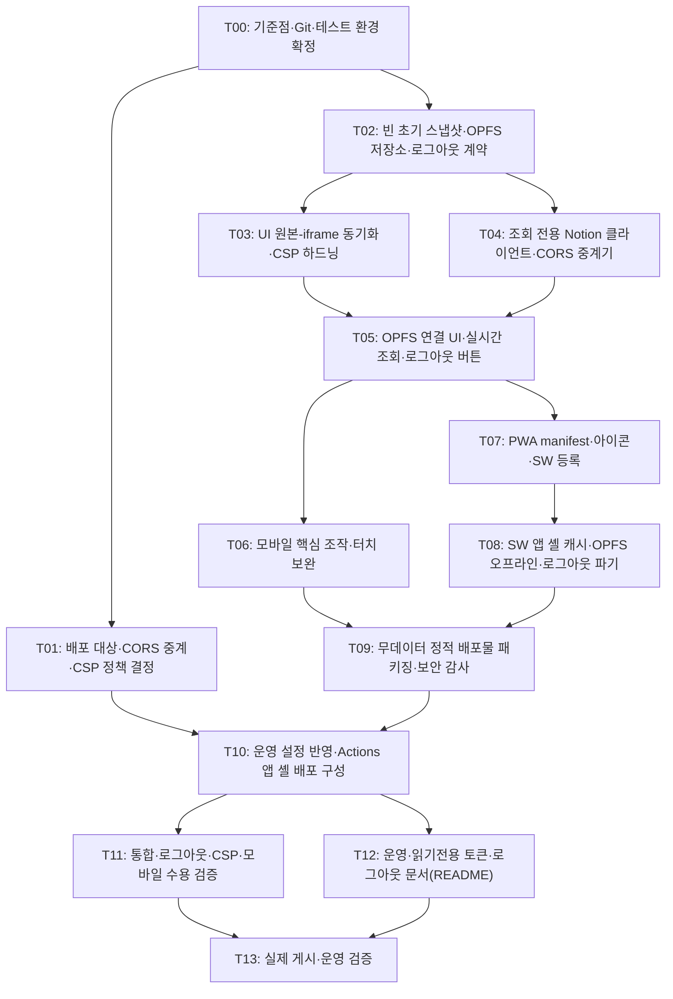

# WIPS Office — GitHub Pages PWA 실행 계획 (`PLAN.md`)

작성일: 2026-11-14  
기준 명세: [SPEC.md](file:///Users/kangseokgyu/workspace/WIPS-Office/SPEC.md) · 참고 계획: [PWA-MIGRATION-PLAN.md](file:///Users/kangseokgyu/workspace/WIPS-Office/PWA-MIGRATION-PLAN.md)

이 문서는 `SPEC.md`에 정의된 보안 강화 PWA 아키텍처(`bean-pocket`의 **OPFS 격리 보관·외부 의존성 제로·자동 산출물 검사** 강점을 채택하고, `bean-pocket`의 미흡했던 **로그아웃(즉시 완전 파기) 버튼 부재·엄격한 CSP 메타 태그 부재·읽기 전용 권한 제한**까지 보완한 구조)를 **독립적이고 원자적인(atomic) 작업 단위(T00~T13)**로 분해한 실행 계획이다.  
현재 작업 디렉터리는 Git 저장소가 초기화되어 있지 않으므로(`.git` 없음), 실제 구현 및 `git worktree` 생성은 **T00** 완료 후 시작한다.

---

## 1. 공통 실행 및 완료 규칙

1. **TDD 원칙 준수**: 동작 변경·추가는 실패하는 테스트 작성 → 의도한 동작 부재로 인한 실패 확인 → 최소 구현 → 영향 범위(`node --test` 등) 재검증 순서로 진행한다.
2. **원자적(Atomic) 작업 단위**: 각 작업은 하나의 검토 가능한 커밋/PR 단위로 완결한다. 무관한 리팩터링, 다른 작업의 파일 수정, 다음 단계 선행 구현을 섞지 않는다.
3. **선행 완료의 정의**: 선행 작업 완료는 "코드/문서 작성 + 자체 검증 통과 + 후속 작업이 분기할 수 있는 확정 커밋 생성"을 뜻한다.
4. **검증 기록 분리**: 작업별 실행 명령, 종료 코드, 결과, 증거 경로는 `docs/verification/Txx/`에 기록하며 비밀정보(`.env`, `NOTION_TOKEN`, 실제 `DATA_SOURCE_ID`)는 절대 포함하지 않는다.
5. **무데이터 & 무식별자(Zero-Data & Zero-Identifier) 원칙**: 정적 배포물(`dist/`)에는 `wips-data.json`뿐만 아니라 실제 `DATA_SOURCE_ID`(`45edae11-...`)와 `SOURCE_URL`도 절대 포함하지 않으며, 배포용 `index.html` 내부 `data-srcdoc`에도 빈 초기 스냅샷(`results: []`)만 포함한다.
6. **생성 파일 단일 소유 및 XSS 방어**: `index.html`의 `data-srcdoc`는 `wips-office.html`을 임베드하는 생성 결과물이므로 병렬 작업 중 수동 편집하지 않는다. 모든 UI 코드는 `innerHTML`/`outerHTML`/`insertAdjacentHTML`/`eval` 사용을 금지하고 `createElement`와 `textContent`만 사용한다.

---

## 2. 작업 간 의존성 및 실행 순서

### 2.1 의존성 그래프



### 2.2 의존성 요약표

| 작업 | 한 줄 요약 | 직접 선행 작업 | 후속 차단 작업 | 병렬 실행 가능 그룹 |
| --- | --- | --- | --- | --- |
| **T00** | Git 저장소·기준 커밋·테스트 기준선 확정 | 없음 | T01, T02 | 단독 (Wave 0) |
| **T01** | GitHub Pages 경로·무상태 CORS 중계·CSP 허용 정책 결정 | T00 | T10 | Wave 1 (`T01 ∥ T02`) |
| **T02** | 빈 초기 스냅샷·OPFS 파일(`connection`/`snapshot`)·로그아웃 계약 | T00 | T03, T04 | Wave 1 (`T01 ∥ T02`) |
| **T03** | `wips-office.html` → `index.html` 동기화(무데이터·외부 CDN CSP 제거) | T02 | T05 | Wave 2 (`T03 ∥ T04`) |
| **T04** | 조회 전용(`query`) Notion 클라이언트 공용 모듈 및 CORS 중계기 | T02 | T05 | Wave 2 (`T03 ∥ T04`) |
| **T05** | OPFS 연결 등록(토큰+ID)·실시간 조회·**로그아웃(`removeEntry`)** | T03, T04 | T06, T07 | Wave 3 (단독) |
| **T06** | 작은 화면 레이아웃·터치 자리배치·저장 복원 | T05 | T09 | Wave 4 (`T06 ∥ T07→T08`) |
| **T07** | `manifest.webmanifest`·아이콘·하위 경로 SW 등록 | T05 | T08 | Wave 4 (`T06 ∥ T07→T08`) |
| **T08** | SW 앱 셸 캐시·버전 교체·로그아웃 시 OPFS/SW 캐시 파기 | T07 | T09 | Wave 4 (`T06 ∥ T07→T08`) |
| **T09** | Allowlist `dist/` 패키징·`verify-dist.mjs` 자동 보안 감사 | T06, T08 | T10 | Wave 5 (통합 패키징) |
| **T10** | GitHub Actions 무데이터 정적 앱 셸 배포 워크플로 구성 | T01, T09 | T11, T12 | Wave 6 (단독) |
| **T11** | 하위 경로 브라우저·OPFS·로그아웃·CSP·모바일 수용 검증 | T10 | T13 | Wave 7 (`T11 ∥ T12`) |
| **T12** | `README.md` 읽기전용 토큰·단일 DB·로그아웃·CORS 가이드 | T10 | T13 | Wave 7 (`T11 ∥ T12`) |
| **T13** | 실제 GitHub Pages 게시·HTTPS·실기기 확인 | T11, T12 | 없음 | Wave 8 (최종 배포) |

### 2.3 실행 순서 설명

- **Wave 0 (`T00`)**: 현재 디렉터리에 `.git`이 없으므로 가장 먼저 Git 저장소를 초기화하고 기준 커밋과 기존 테스트(`node --test`) 기준선을 기록한다.
- **Wave 1 (`T01 ∥ T02`)**: 운영/보안 정책 결정(`T01`: 배포 저장소 경로, 무상태 CORS 중계 주소, 최소 권한 CSP 허용 목록)과 데이터/OPFS/로그아웃 계약(`T02`: 빈 초기 스냅샷, OPFS 파일 구조, 로그아웃 시 삭제 대상 계약)을 병렬로 진행한다.
- **Wave 2 (`T03 ∥ T04`)**: `T02` 계약 확정 후, 무데이터 주입 및 외부 CDN CSP 제거를 포함하는 동기화 스크립트(`T03`)와 조회 전용(`POST /v1/data_sources/{id}/query`) Notion 클라이언트·CORS 중계기(`T04`)를 별도 `git worktree`에서 병렬 개발한다.
- **Wave 3 (`T05`)**: `T03`과 `T04`를 통합한 뒤, 정적 환경에서의 **OPFS 연결 설정(읽기 전용 토큰 + 데이터 소스 ID + 권한 안내), 실시간 조회, 오류 유지, 그리고 로그아웃 버튼(진행 중 요청 취소 + OPFS `removeEntry` + 화면 즉시 초기화)**을 구현한다.
- **Wave 4 (`T06 ∥ T07 → T08`)**: `T05` 완료 후, 모바일 터치/레이아웃 보완(`T06`, `wips-office.html` 소유)과 PWA 셸/메타데이터(`T07`, `manifest`/아이콘/등록 모듈/외부 `index.html` 셸 소유)를 병렬 worktree로 진행한다. `T08`(Service Worker 앱 셸 캐시 및 로그아웃 시 데이터 캐시 연동 파기)은 `T07` 완료 후 이어서 진행한다.
- **Wave 5 (`T09`)**: `T06`과 `T08`이 통합된 상태에서 `wips-data.json`·실제 `DATA_SOURCE_ID`·외부 CDN CSP·토큰·`innerHTML` 등이 전혀 없는지 검사하는 `verify-dist.mjs` 및 `dist/` 패키징을 구현·검증한다.
- **Wave 6 (`T10`)**: `T01`의 운영 설정과 `T09`의 패키징/보안 감사를 연결해 GitHub Actions 워크플로를 작성한다.
- **Wave 7 (`T11 ∥ T12`)**: 최종 배포 후보(`dist/`)에 대한 통합·로그아웃·CSP·모바일 수용 검증(`T11`)과 운영·보안 문서화(`T12`)를 병렬로 진행한다.
- **Wave 8 (`T13`)**: `T11`, `T12` 완료 및 사용자 merge 승인 후 실제 GitHub Pages에 게시하고 모바일 기기에서 실시간 조회와 로그아웃을 최종 확인한다.

---

## 3. 작업별 상세 명세 (Atomic Tasks)

### T00 — 기준점과 실행 환경 확정

- **목표**: `git worktree` 기반 병렬 작업을 시작할 수 있도록 Git 저장소 상태, 기준 커밋, 기존 테스트 기준선을 확보한다.
- **선행 의존성**: 없음
- **소유 파일**: `.gitignore`, `docs/verification/T00/`
- **구체적 결과물**:
  - Git 저장소 초기화 여부 확인 및 필요 시 `git init` + 초기 기준 커밋(`main`) 생성 (`.env`, `dist/`, `node_modules/`가 `.gitignore`로 제외되는지 확인)
  - `docs/verification/T00/baseline.md`: 기준 커밋 해시, 추적 파일 목록, `node --test` 실행 결과, 브라우저 검증 도구 가용 여부 기록
- **검증 기준**:
  - `git status` 및 `git worktree list`가 오류 없이 실행된다.
  - `.env` 파일이 `git status --ignored`에서 무시 상태임을 확인한다.
  - `node --test` 실행 결과가 있는 그대로 기록된다.
- **하면 안 되는 것**:
  - `.env`나 비밀정보를 Git 커밋에 포함하기
  - 기존 파일(`wips-data.json`, `server.mjs`, `wips-office.html`)의 동작 코드를 임의로 수정하기
  - 실패한 테스트를 통과한 것처럼 기록하거나 원인을 숨기기

---

### T01 — 배포 대상·무상태 CORS 중계·CSP 보안 정책 결정

- **목표**: 정적 PWA가 게시될 GitHub Pages 경로, 본인 소유 무상태 CORS 중계 규격, 그리고 외부 CDN을 배제한 CSP 허용 정책을 확정한다.
- **선행 의존성**: T00
- **소유 파일**: `docs/pwa-release-decisions.md`
- **구체적 결과물**:
  - `docs/pwa-release-decisions.md`:
    - 대상 GitHub 저장소 이름 및 Pages 하위 경로(`/repo-name/`)
    - 브라우저 → Notion API 호출 시 사용할 본인 소유 무상태 CORS 중계 엔드포인트 규격(허용 Origin 고정, `POST /v1/data_sources/:id/query`만 허용, 토큰/응답 미저장·미로깅)
    - CSP 최소 권한 정책(`cdnjs`, `jsdelivr`, `esm.sh`, `unpkg`, `oaistatic` 등 기존 `index.html`의 외부 CDN 도메인 전면 제거, `connect-src` 허용 목록 확정)
    - Notion Integration 발급 지침(**Read content 전용**, WIPS 단일 DB 연결, 공용 PC 사용 금지)
- **검증 기준**:
  - 배포 경로, CORS 중계 규격, CSP 정책, 토큰 권한 제한 지침이 명시되어 `T03`, `T04`, `T09`, `T10`, `T12`에서 그대로 참조할 수 있다.
- **하면 안 되는 것**:
  - 제3자 무료 공개 CORS 프록시를 허용 목록에 넣기
  - 중계기에 토큰이나 업무 데이터를 캐시·로깅하도록 설계하기
  - 기존 `index.html`에 남아 있던 외부 CDN 도메인들을 CSP에 그대로 남기기

---

### T02 — 빈 초기 스냅샷·OPFS 격리 저장소·로그아웃 계약 정의

- **목표**: 배포물에 업무 데이터와 DB 식별자를 전혀 넣지 않으면서도 화면(`T03`, `T05`)과 조회 모듈(`T04`)을 병렬 개발할 수 있도록 데이터·OPFS 저장소·로그아웃 계약을 고정한다.
- **선행 의존성**: T00
- **소유 파일**: `contracts/snapshot-contract.md`, `lib/snapshot-schema.mjs`, `lib/opfs-store.mjs`, `fixtures/empty-snapshot.json`, `fixtures/sample-snapshot.json`, `tests/snapshot-schema.test.mjs`, `tests/opfs-store.test.mjs`
- **구체적 결과물**:
  - 배포용 빈 초기 스냅샷(`fixtures/empty-snapshot.json`: `results: []`, `sourceUrl: ""`, 실제 ID 미포함) 및 테스트용 가상 샘플(`fixtures/sample-snapshot.json`)
  - 스키마/계약 문서(`contracts/snapshot-contract.md`) 및 검증 모듈(`lib/snapshot-schema.mjs`):
    - 로컬 서버 모드(`/api/tasks`) vs 정적 PWA 모드(OPFS 연결 기반 실시간 조회) 판별 계약
  - OPFS 격리 저장소 모듈(`lib/opfs-store.mjs`):
    - 브라우저 전용 비공개 디렉터리(`wips-office-private-v1`) 내에 `connection.json`(토큰, `dataSourceId`, `corsProxyUrl`, 제어 문자·UUID 검증)과 `snapshot-cache.json`(마지막 성공 스냅샷)을 읽고·쓰고·원자적으로 삭제(`removeEntry`)하는 순수 추상화
    - **로그아웃 파기 계약**: `clearAll()` 호출 시 `connection.json`과 `snapshot-cache.json`을 모두 `removeEntry`로 삭제하고 이후 읽기 시 `null`을 반환함을 보장 (`localStorage`에 토큰이나 업무 스냅샷을 저장하지 않음)
- **검증 기준**:
  - 정상 스냅샷, 빈 초기 스냅샷, 잘못된 스냅샷을 검증 함수가 정확히 구분한다.
  - mock OPFS(`getDirectory`, `getFileHandle`, `removeEntry`) 환경에서 연결/스냅샷 저장·읽기백(readback) 검증·`clearAll()` 호출 후 완전 삭제 및 미지원 환경 예외 처리가 단위 테스트로 통과한다.
- **하면 안 되는 것**:
  - 기존 `wips-data.json`의 실제 사내 업무 데이터나 실제 `DATA_SOURCE_ID`를 배포용 fixture에 넣기
  - 토큰이나 업무 스냅샷을 `localStorage`·`sessionStorage`·`indexedDB`에 저장하도록 설계하기
  - 실제 Notion 토큰을 테스트 코드에 하드코딩하기

---

### T03 — UI 원본과 iframe 실행본 동기화 자동화 및 CSP 하드닝

- **목표**: `wips-office.html` 변경을 `index.html`의 `data-srcdoc`에 결정적으로 반영하되, 정적 배포 빌드 시 빈 초기 스냅샷을 주입하고 **외부 CDN 도메인이 전면 제거된 엄격한 CSP**를 강제한다.
- **선행 의존성**: T02
- **소유 파일**: `scripts/sync-office.mjs`, `tests/sync-office.test.mjs`
- **구체적 결과물**:
  - 결정적 동기화 스크립트(`scripts/sync-office.mjs`):
    - 정적 배포용 무데이터 모드(`--empty` / `fixtures/empty-snapshot.json`) 시 `wips-office-data`를 빈 스냅샷으로 치환하고 실제 `DATA_SOURCE_ID`·`SOURCE_URL`이 `index.html`에 남지 않도록 빌드
    - `index.html`과 `data-srcdoc`의 `<meta http-equiv="Content-Security-Policy">`에서 외부 CDN 도메인(`cdnjs.cloudflare.com`, `cdn.jsdelivr.net`, `esm.sh`, `unpkg.com`, `fonts.googleapis.com`, `fonts.bunny.net`, `fonts.gstatic.com`, `persistent.oaistatic.com`)을 모두 제거하고 최소 권한 CSP를 주입하는 옵션/규칙 지원
  - 동기화 일관성·무데이터·CSP 하드닝 회귀 테스트(`tests/sync-office.test.mjs`)
- **검증 기준**:
  - 동일 입력에 대해 바이트 단위로 동일한 `index.html`이 생성된다.
  - 정적 배포 모드로 생성한 `index.html` 및 `data-srcdoc`에 `wips-data.json` 업무 제목, 실제 `DATA_SOURCE_ID`, `SOURCE_URL`, 외부 CDN 도메인 문자열이 0건임을 테스트로 검증한다.
  - 기존 `node --test`가 통과한다.
- **하면 안 되는 것**:
  - `wips-office.html`과 `index.html`을 서로 다르게 수동 유지하기
  - 정적 배포용 `index.html`에 실제 `wips-data.json` 데이터나 외부 CDN CSP를 남기기

---

### T04 — 조회 전용(Read-Only) Notion 클라이언트 공용 모듈 및 무상태 CORS 중계기

- **목표**: `server.mjs`의 검증된 Notion 조회·페이지네이션·매핑·429·타임아웃 로직을 브라우저에서도 재사용할 수 있게 분리하되 **오직 조회(`POST /v1/data_sources/{id}/query`)만 허용**하고, 본인 소유의 초경량 무상태 CORS 중계 스크립트를 제공한다.
- **선행 의존성**: T02
- **소유 파일**: `lib/notion-client.mjs`, `scripts/cors-proxy-worker.mjs`, `server.mjs`(공용 모듈 import 리팩터링), `tests/notion-client.test.mjs`
- **구체적 결과물**:
  - 조회 전용 공용 모듈(`lib/notion-client.mjs`):
    - `fetchNotionSnapshot`, `mapNotionPage`, `parseRetryAfter`, `NotionApiError` 제공
    - 토큰 제어 문자 검증, `dataSourceId` UUID 검증, `redirect: 'error'`, `credentials: 'omit'`, `cache: 'no-store'` 적용 (`bean-pocket`의 엄격한 네트워크 가드 채택)
    - 페이지 생성(`POST /pages`), 수정(`PATCH /pages`), 삭제 메서드를 일절 제공하지 않음(조회 전용 강제)
  - 무상태 CORS 중계 스크립트(`scripts/cors-proxy-worker.mjs`):
    - 허용된 Origin(GitHub Pages 출처)만 `Access-Control-Allow-Origin` 허용
    - `OPTIONS` 프리플라이트 및 `POST /v1/data_sources/{uuid}/query` 경로만 Notion API로 전달하고 나머지 경로(`/v1/pages`, `/v1/users` 등)는 `403`/`404` 거부
    - 요청자의 `Authorization` 토큰이나 응답 데이터를 저장·캐시·로그 출력하지 않음
  - 다중 페이지, 429 `Retry-After`, 타임아웃, `incomplete` 응답, 쓰기 경로 차단 테스트(`tests/notion-client.test.mjs`)
- **검증 기준**:
  - 기존 `server.test.mjs`가 모두 통과하며 로컬 `/api/tasks` 동작이 유지된다.
  - 커스텀 `apiRoot`(CORS 중계 주소)와 기기 입력 토큰·`dataSourceId`로 mock Notion 조회가 정상 동작하며, 중계기가 `/v1/pages` 등 비조회 경로 요청을 차단한다.
  - 토큰이나 응답 본문이 로그에 출력되지 않는다.
- **하면 안 되는 것**:
  - 서버용과 브라우저용 Notion 매핑/페이지네이션 코드를 중복 작성하기
  - Notion 쓰기(생성/수정/삭제) API 호출 코드를 클라이언트에 추가하기
  - 중계기에 토큰이나 응답을 로깅·캐시하기

---

### T05 — OPFS 연결 설정·실시간 Notion 조회·로그아웃 버튼 구현

- **목표**: 정적 배포 환경에서 사용자가 본인 기기의 OPFS에만 읽기 전용 토큰과 데이터 소스 ID를 저장해 실시간으로 업무 현황을 조회하고, **로그아웃 버튼** 한 번으로 OPFS 연결 파일·스냅샷 캐시·화면 데이터를 즉시 완전 삭제할 수 있게 한다.
- **선행 의존성**: T03, T04
- **소유 파일**: `wips-office.html`, `tests/auth-and-live-query.test.mjs` (완료 시 `T03` 스크립트로 동기화)
- **구체적 결과물**:
  - **모드 자동 구분**: 로컬 서버 모드(`/api/tasks` 사용) vs 정적 PWA 모드(OPFS 연결 기반 실시간 Notion 조회)
  - **OPFS 연결 설정 UI (정적 모드)**:
    - 저장된 연결이 없을 때 업무 데이터 대신 연결 설정 패널 표시: Notion 토큰(`type="password"`, `autocomplete="off"`), 데이터 소스 ID(UUID 형식 안내), CORS 중계 URL 입력
    - UI 내 보안 체크리스트 명시: **"① Notion Integration에서 `Read content` 권한만 허용, ② WIPS DB 페이지 하나에만 연결, ③ 공용 PC에서 입력 금지"**
    - 연결 조회 성공 시 OPFS `wips-office-private-v1/connection.json`과 `snapshot-cache.json`에 저장하고, 재접속 시 자동 복원·조회
  - **실시간 새로고침 및 상태 표시**:
    - `지금 갱신` 시 저장된 연결 정보로 Notion 최신 데이터를 재조회하고 마지막 성공 시각 표시
    - 일시적 네트워크/API 오류 시 현재 화면의 마지막 정상 데이터를 유지하고 오류 상태 표시 (401/403 시 연결 설정 재확인 안내)
    - UI 렌더링 시 `innerHTML`/`outerHTML`/`eval` 미사용 (`createElement` + `textContent` 유지)
  - **로그아웃 버튼**:
    - 상단 컨트롤 영역에 `로그아웃` 버튼 배치 (정적 모드에서 연결 정보 또는 캐시된 데이터가 있을 때 표시)
    - 클릭 즉시:
      1. 진행 중인 `fetch` 요청 중단(`AbortController`) 및 자동 갱신 타이머 해제
      2. OPFS 내 `connection.json` 및 `snapshot-cache.json`을 `removeEntry`로 즉시 삭제 (`opfsStore.clearAll()`)
      3. Service Worker 데이터 캐시 삭제 훅 호출
      4. 메모리 내 `snapshot`/`model`을 빈 초기 상태(`results: []`)로 교체하고 DOM의 직원 말풍선·상세 카드·미배정 일감 목록을 즉시 비움
      5. 초기 연결 설정 화면으로 전환 및 `"로그아웃되었습니다. 이 기기에서 토큰·연결 정보와 업무 데이터를 삭제했습니다."` 안내 표시
- **검증 기준**:
  - 미연결 상태에서 화면에 어떤 업무 제목·담당자·DB ID도 표시되지 않는다.
  - 유효한 연결(mock 중계 서버) 입력 시 실시간 조회 결과가 렌더링되고 OPFS에 보관되며, 새로고침 시 최신 데이터로 갱신된다.
  - **로그아웃 검증**: 로그아웃 버튼 클릭 즉시 OPFS의 연결 파일과 스냅샷 캐시가 `removeEntry`로 삭제되고, 화면의 모든 일감 카드가 제거되며, 페이지를 새로고침해도 이전 업무 데이터가 절대 다시 나타나지 않는다.
  - 로컬 서버 모드(`node server.mjs`)에서는 기존처럼 연결 입력 없이 `/api/tasks`로 동작한다.
- **하면 안 되는 것**:
  - 토큰이나 업무 스냅샷을 `localStorage`에 저장하거나 URL 쿼리스트링(`?token=...`)에 노출하기
  - `innerHTML`, `outerHTML`, `insertAdjacentHTML`, `eval` 사용하기
  - 로그아웃 시 토큰만 지우고 `snapshot-cache.json`이나 화면 DOM을 남겨두기
  - 실패한 응답으로 기존 정상 화면 데이터를 덮어쓰기

---

### T06 — 모바일 핵심 조작 보완

- **목표**: 작은 모바일 화면과 터치 환경에서 연결 설정/로그아웃, 사무실 이동, 직원 선택, 상세 카드, 필터, 자리 배치·저장 복원이 막힘없이 동작하게 한다.
- **선행 의존성**: T05
- **소유 파일**: `wips-office.html`, `tests/mobile-layout.test.mjs` (완료 시 `T03`으로 동기화)
- **구체적 결과물**:
  - 좁은 뷰포트(360px~430px)에서 상단 바(`지금 갱신`, `자리 배치`, `로그아웃` 버튼), 연결 설정 폼, 필터, 사무실 영역, 상세 카드가 잘리거나 겹치지 않는 반응형 스타일 보완
  - 터치 스크롤과 직원 선택 탭의 충돌 방지, 선택 메뉴(`select`) 기반 자리 배치 조작성 및 브라우저 저장/복원 검증
- **검증 기준**:
  - 모바일 뷰포트(375x667 등)에서 `로그아웃` 버튼을 포함한 모든 주요 컨트롤이 화면 밖으로 잘리지 않고 터치 가능하다.
  - 자리 교환 후 재실행 시 배치가 복원되며, 저장 차단 시 안내 메시지가 정상 표시된다.
- **하면 안 되는 것**:
  - 자리 배치의 서버/기기 간 동기화 기능 추가하기
  - `index.html` 외부 셸(`<head>`, manifest 링크 등 `T07` 소유 영역) 직접 수정하기
  - 브라우저 에뮬레이션 결과를 실제 모바일 기기 검증 완료로 둔갑시키기

---

### T07 — PWA 메타데이터와 등록 진입점

- **목표**: GitHub Pages 하위 경로(`/repo-name/`)에서 홈 화면 추가가 가능하도록 `manifest`, 앱 아이콘, Service Worker 등록 진입점을 구성하고, 외부 `index.html` 셸에도 엄격한 CSP를 적용한다.
- **선행 의존성**: T05
- **소유 파일**: `manifest.webmanifest`, `icons/`, `pwa-register.js`, `index.html` (외부 셸 `<head>`/`<body>` 영역), `tests/pwa-manifest.test.mjs`
- **구체적 결과물**:
  - `manifest.webmanifest`: 앱 이름, `short_name`, `display: "standalone"`, 상대 경로 기반 `start_url` (`./`) 및 `scope` (`./`), 아이콘 목록
  - 앱 아이콘(`icons/icon-192.png`, `icons/icon-512.png`)
  - 별도 등록 모듈(`pwa-register.js`): `new URL('./sw.js', import.meta.url)`(또는 상대 경로) 등록, 로그아웃 이벤트 수신 시 Service Worker 데이터/보조 캐시 정리 메시지 전달, 등록 실패 시 안전한 예외 처리
  - `index.html` 외부 셸에 manifest·아이콘·`pwa-register.js` 연결 및 외부 CDN 도메인을 완전히 제거한 최소 권한 CSP 반영
- **검증 기준**:
  - 하위 경로(`/repo-name/`) 서빙 시 `manifest.webmanifest`, 아이콘, `pwa-register.js`가 모두 정상 로드된다.
  - Service Worker 미지원/등록 실패 환경에서도 화면과 실시간 Notion 조회가 정상 작동한다.
- **하면 안 되는 것**:
  - 루트 절대 경로(`/manifest.webmanifest`, `/sw.js`) 하드코딩하기
  - 외부 CDN 도메인을 CSP에 다시 추가하기
  - `wips-office.html` 내부 UI 코드 수정하기

---

### T08 — Service Worker 앱 셸 캐시·업데이트 및 로그아웃 시 오프라인 데이터 완전 파기

- **목표**: 앱 셸(정적 코드·아이콘)을 Service Worker로 캐시하고 새 버전 배포 시 안전하게 교체하며, 로그인 상태에서 OPFS `snapshot-cache.json`을 통해 오프라인 마지막 데이터를 보여주되 **로그아웃 시 OPFS와 SW 캐시를 모두 즉시 파기**한다.
- **선행 의존성**: T07 (`T06`과 UI 상태 연결이 겹칠 경우 `T06` 완료 후 연결)
- **소유 파일**: `sw.js`, `pwa-register.js`, `tests/pwa-offline-update.test.mjs`
- **구체적 결과물**:
  - `sw.js`:
    - `bean-pocket` 방식의 `scope` 기반 캐시 prefix 및 빌드 버전 캐시 이름 관리, `install` 시 `{ cache: 'reload' }`로 허용된 정적 앱 셸 파일만 캐시
    - `activate` 시 같은 scope의 구버전 앱 셸 캐시만 정리 (다른 사이트/경로 캐시 미삭제)
    - **Notion API 요청/응답(`Authorization` 헤더 포함)은 Service Worker 캐시에 절대 저장하지 않음** (`GET` 정적 앱 셸만 캐시 처리)
  - 오프라인 상태 시(OPFS 연결이 유효한 상태에 한해) OPFS `snapshot-cache.json`의 마지막 성공 스냅샷과 데이터 기준 시각 복원 및 오프라인 배너 표시
  - **로그아웃 연동 캐시 파기**: 로그아웃 시 OPFS `connection.json`과 `snapshot-cache.json` 삭제 및 SW 메시지(`clear-session`) 연동으로 오프라인 재실행 시에도 업무 데이터가 전혀 표시되지 않도록 처리
- **검증 기준**:
  - **로그인 + 정상 조회 → 오프라인 전환 → 재실행**: OPFS의 마지막 성공 데이터와 기준 시각, 오프라인 상태가 표시된다.
  - **로그아웃 → 오프라인 전환 → 재실행**: 이전 업무 데이터가 전혀 표시되지 않고 미연결(로그아웃) 상태가 유지된다.
  - **새 버전 배포**: 캐시 버전 변경 시 새 앱 셸 리소스가 반영되고 구버전 캐시가 정리된다.
- **하면 안 되는 것**:
  - Service Worker 캐시에 Notion API 응답, 토큰, `Authorization` 헤더를 저장하기
  - 다른 scope의 캐시를 삭제하거나 오류 응답으로 OPFS `snapshot-cache.json`을 덮어쓰기

---

### T09 — 무데이터 정적 배포물 패키징과 자동 보안 감사 (`verify-dist.mjs`)

- **목표**: `bean-pocket`의 `check-pages.mjs` 수준 이상으로 배포 산출물을 엄격하게 통제·감사하여, 허용된 정적 앱 셸만 `dist/`에 생성하고 데이터·식별자·토큰·위험 API·외부 CDN CSP가 단 1건도 없음을 자동 검증한다.
- **선행 의존성**: T06, T08
- **소유 파일**: `scripts/build-pages.mjs`, `scripts/verify-dist.mjs`, `tests/build-pages.test.mjs`
- **구체적 결과물**:
  - 정적 빌드 스크립트(`scripts/build-pages.mjs`):
    - `T03`을 무데이터·CSP 하드닝 모드로 실행해 `dist/index.html` 생성 (빌드 해시 버전 치환 포함)
    - 허용된 정적 파일 allowlist(`index.html`, `manifest.webmanifest`, `sw.js`, `pwa-register.js`, `icons/`)만 `dist/`에 출력 (`wips-data.json` 제외, 심볼릭 링크 차단)
  - 산출물 보안 감사 스크립트(`scripts/verify-dist.mjs`):
    - `dist/` 내 심볼릭 링크 및 allowlist 외 파일(`wips-data.json`, `.env`, `server.mjs`, `*.test.mjs`) 차단
    - `dist/`의 모든 텍스트 파일(`index.html` 및 `data-srcdoc` 내부 포함) 전수 검사:
      1. 루트 `wips-data.json`의 실제 일감 제목 및 실제 `DATA_SOURCE_ID`(`00000000-0000-4000-8000-000000000000`), `SOURCE_URL` 문자열 잔류 차단
      2. 토큰 패턴(`ntn_`, `secret_`, 하드코딩된 credential) 차단
      3. 외부 CDN 도메인(`cdnjs.cloudflare.com`, `cdn.jsdelivr.net`, `esm.sh`, `unpkg.com`, `oaistatic.com` 등) 차단
      4. DOM XSS·위험 저장소 패턴(`innerHTML`, `outerHTML`, `insertAdjacentHTML`, `eval(`, `new Function`, 토큰용 `localStorage` 등) 차단
      5. `index.html` 및 `data-srcdoc`에 필수 `Content-Security-Policy` 메타 태그 존재 및 루트 절대 경로(`/...`) 부재 검증
      6. `manifest.webmanifest`, PNG 아이콘 크기, `sw.js` 빌드 버전/scope 정합성 검증
- **검증 기준**:
  - `node scripts/build-pages.mjs && node scripts/verify-dist.mjs`가 종료 코드 0으로 통과한다.
  - 테스트에서 `dist/`에 `wips-data.json`, 실제 일감 제목, 실제 `DATA_SOURCE_ID`, 가짜 토큰, 외부 CDN CSP, `innerHTML`, 심볼릭 링크를 각각 주입했을 때 모두 0이 아닌 종료 코드로 차단함을 확인한다.
- **하면 안 되는 것**:
  - `wips-data.json`이나 실제 `DATA_SOURCE_ID`/`SOURCE_URL`을 `dist/`에 포함하기
  - `data-srcdoc` 내부 문자열 검사를 건너뛰기

---

### T10 — 운영 설정 반영과 GitHub Actions 배포 구성

- **목표**: 코드 변경 시 무데이터 정적 앱 셸(`dist/`)을 빌드·검증하고, 전체 테스트 및 `verify-dist.mjs` 보안 감사를 통과한 경우에만 GitHub Pages에 배포하는 워크플로를 구성한다.
- **선행 의존성**: T01, T09
- **소유 파일**: `.github/workflows/deploy-pages.yml`
- **구체적 결과물**:
  - `.github/workflows/deploy-pages.yml`:
    - `workflow_dispatch`(수동 실행) 또는 승인된 기본 브랜치 `push` 트리거
    - 최소 권한(`contents: read`, `pages: write`, `id-token: write`), `actions/checkout` 시 `persist-credentials: false`, `concurrency` 설정
    - `node --test` → `node scripts/build-pages.mjs` → `node scripts/verify-dist.mjs` → 모두 성공 시에만 `actions/upload-pages-artifact` 및 `actions/deploy-pages` 실행
- **검증 기준**:
  - 테스트 또는 `verify-dist.mjs`가 실패하면 Pages 배포 job이 절대 실행되지 않는다.
  - 워크플로에 `NOTION_TOKEN` Secret이나 스냅샷 빌드 단계가 없어 배포 아티팩트에 업무 데이터가 유입될 경로가 원천 차단된다.
- **하면 안 되는 것**:
  - Actions 빌드 단계에서 Notion API를 호출해 데이터를 `dist/`에 구워 넣기
  - 보안 감사(`verify-dist.mjs`) 없이 Pages 아티팩트를 업로드하기

---

### T11 — 통합·로그아웃·CSP·모바일 수용 검증

- **목표**: 최종 배포 후보(`dist/`)가 `SPEC.md`의 모든 보안·기능·모바일 요구사항을 충족함을 브라우저 환경에서 증명한다.
- **선행 의존성**: T10
- **소유 파일**: `docs/verification/T11/` (제품 코드 수정 금지)
- **구체적 결과물**:
  - `docs/verification/T11/acceptance-report.md`: 기준 커밋·산출물 해시 및 `SPEC.md` 수용 기준별 검증 결과표:
    1. 기존 로컬 서버 회귀(`node --test`)
    2. 배포물 보안(`wips-data.json`, 실제 `DATA_SOURCE_ID`/`SOURCE_URL`, 업무 데이터, 외부 CDN CSP 0건 확인)
    3. 미연결 상태 접속 시 초기 빈 화면 확인
    4. OPFS 연결 등록 후 조회 전용 실시간 조회·필터·직원 선택·자리 배치·새로고침 확인
    5. **로그아웃 버튼 클릭 시 OPFS 연결/스냅샷 캐시(`removeEntry`), SW 캐시, 화면 메모리·DOM 즉시 삭제 및 새로고침/오프라인 재실행 시 데이터 미노출 확인**
    6. CSP 정책 동작(인라인 외 외부 스크립트 차단) 및 로그인 상태 오프라인 복원/버전 업데이트 확인
    7. 모바일 뷰포트 및 실기기(또는 에뮬레이션 구분) 검증 기록
- **검증 기준**:
  - 저장소 하위 경로(`/repo-name/`)로 서빙되는 실제 브라우저 환경에서 위 시나리오가 모두 검증되고 증거(로그·스크린샷)가 남는다.
  - 결함 발견 시 즉흥 수정하지 않고 해당 소유 작업(`T03`~`T09`)으로 반환해 수정 후 재검증한다.
- **하면 안 되는 것**:
  - 검증 브랜치에서 제품 코드를 직접 수정하기
  - 에뮬레이션 결과를 실제 Android/iPhone 기기 검증으로 허위 기록하기

---

### T12 — 운영·읽기 전용 토큰·로그아웃 가이드 문서 완성

- **목표**: 사용자가 안전하게 읽기 전용 토큰을 발급·등록하고, 본인 소유 CORS 중계를 연결하며, 모바일 홈 화면 설치 및 로그아웃으로 데이터를 파기하는 전체 절차를 문서화한다.
- **선행 의존성**: T10
- **소유 파일**: `README.md`
- **구체적 결과물**:
  - `README.md` 개정:
    - 로컬 서버 실행(`node server.mjs`) vs 정적 PWA 실행 비교
    - **보안 가이드**: Notion Integration 생성 시 **Read content(콘텐츠 읽기)만 체크**하고 **WIPS DB 하나에만 연결**하는 방법, **공용 PC 사용 금지** 안내, 본인 소유 무상태 CORS 중계 배포 방법(`scripts/cors-proxy-worker.mjs`)
    - OPFS 격리 보관 원리 및 최초 연결(토큰 + 데이터 소스 ID) 방법
    - **로그아웃 버튼 안내**: 로그아웃 시 기기 OPFS·캐시·화면에서 즉시 삭제되는 항목 설명
    - 모바일(Android Chrome / iPhone Safari) 홈 화면 추가 절차 및 장애 확인 방법
- **검증 기준**:
  - 문서의 모든 명령, UI 버튼 이름(`로그아웃`, `지금 갱신`, `자리 배치`), 설정 경로가 실제 구현과 일치한다.
- **하면 안 되는 것**:
  - 실제 토큰 값이나 실제 `DATA_SOURCE_ID`·`SOURCE_URL`을 공개 문서 예시에 적기
  - 공용 PC에서도 안전하다고 안내하거나 제3자 공개 CORS 프록시 사용을 권장하기

---

### T13 — 실제 게시와 운영 확인

- **목표**: 사용자 승인 후 무데이터 정적 PWA를 GitHub Pages에 게시하고, 실제 HTTPS 주소와 모바일 기기에서 실시간 조회·오프라인·로그아웃 동작을 최종 확인한다.
- **선행 의존성**: T11, T12
- **소유 파일**: `docs/verification/T13/release-report.md`
- **구체적 결과물**:
  - `docs/verification/T13/release-report.md`:
    - 게시 URL, 배포 커밋 해시, Actions 실행 ID
    - 토큰/연결 없는 시크릿 브라우저로 게시 URL 접속 시 업무 데이터 및 DB 식별자가 전혀 보이지 않음 확인
    - 개인 모바일 기기에서 연결 등록 → 조회 전용 실시간 조회 → 홈 화면 실행 → 오프라인 조회 → **로그아웃 후 OPFS/캐시/화면 데이터 완전 삭제** 확인 기록
- **검증 기준**:
  - 사용자 merge 및 배포 승인 후에만 게시한다.
  - 실제 게시된 사이트 소스·네트워크 응답 어디에도 `wips-data.json`, 실제 `DATA_SOURCE_ID`, 내장 업무 데이터가 없음을 확인한다.
- **하면 안 되는 것**:
  - 사용자 승인 없이 merge 또는 원격 push/배포 실행하기
  - 검증되지 않은 항목을 완료로 기록하기

---

## 4. 병렬 작업을 위한 `git worktree` 운영 가이드

### 4.1 사전 조건 (`T00` 완료 필수)
현재 디렉터리(`/Users/kangseokgyu/workspace/WIPS-Office`)는 Git 저장소가 아니므로, **T00에서 `git init` 및 기준 커밋을 생성한 뒤**에만 아래 worktree 명령을 사용한다.

### 4.2 Worktree 디렉터리 및 브랜치 규칙
- 메인 작업 트리는 기준 브랜치(`main`)를 유지하고, 병렬 작업은 상위 폴더에 별도 worktree를 생성해 격리한다.
- 브랜치 네이밍: `pwa/tXX-short-name`
- 하나의 브랜치를 여러 worktree에서 동시에 체크아웃하지 않는다.

```bash
# 예시 1: Wave 1 (T01 ∥ T02) 병렬 실행 (T00 완료 커밋 main 기준)
git worktree add ../WIPS-Office-t01 -b pwa/t01-decisions main
git worktree add ../WIPS-Office-t02 -b pwa/t02-contracts-opfs main

# 예시 2: Wave 2 (T03 ∥ T04) 병렬 실행 (T02 완료 커밋 기준)
git worktree add ../WIPS-Office-t03 -b pwa/t03-sync-csp pwa/t02-contracts-opfs
git worktree add ../WIPS-Office-t04 -b pwa/t04-readonly-client pwa/t02-contracts-opfs

# 예시 3: Wave 4 (T06 ∥ T07) 병렬 실행 (T05 완료 커밋 기준)
git worktree add ../WIPS-Office-t06 -b pwa/t06-mobile-ux pwa/t05-opfs-auth-logout
git worktree add ../WIPS-Office-t07 -b pwa/t07-pwa-shell pwa/t05-opfs-auth-logout
```

### 4.3 파일 소유권 및 충돌 방지 매트릭스

| 파일 / 영역 | 소유 작업 | 병렬 시 주의사항 |
| --- | --- | --- |
| `docs/pwa-release-decisions.md` | T01 | 다른 작업과 겹치지 않음 |
| `contracts/`, `fixtures/`, `lib/snapshot-schema.mjs`, `lib/opfs-store.mjs` | T02 | T02 완료 후 임의 변경 금지 |
| `scripts/sync-office.mjs` | T03 | `wips-office.html` 비즈니스 로직 수정 금지 |
| `lib/notion-client.mjs`, `scripts/cors-proxy-worker.mjs`, `server.mjs` | T04 | 조회 전용 제한 및 기존 `server.test.mjs` 유지 |
| `wips-office.html` (OPFS 연결 UI·실시간 조회·**로그아웃 버튼**) | T05 | T03, T04 통합 후 단독 진행 |
| `wips-office.html` (모바일 스타일·터치 조작) | T06 | T05 완료 후 수정 (`index.html` 외부 셸 수정 금지) |
| `manifest.webmanifest`, `icons/`, `pwa-register.js`, `index.html`(외부 셸) | T07 | `index.html`의 `data-srcdoc` 내부는 수동 편집 금지 |
| `sw.js`, 오프라인/로그아웃 캐시 삭제 연동 | T08 | T07 완료 후 진행, T06과 UI 영역 충돌 시 T06 merge 후 연결 |
| `scripts/build-pages.mjs`, `scripts/verify-dist.mjs` | T09 | T06, T08 통합 후 실행 |
| `.github/workflows/deploy-pages.yml` | T10 | T01, T09 완료 후 작성 |
| `README.md` | T12 | T11과 완전 병렬 가능 |

### 4.4 테스트·환경 격리 규칙
1. **서버 포트 분리**: 병렬 worktree에서 로컬 HTTP/중계 테스트를 동시에 실행할 때는 `port: 0`(동적 포트) 또는 worktree별 고유 포트를 사용한다.
2. **브라우저 프로필/Origin 분리**: `T05`/`T07`/`T08`의 OPFS(`wips-office-private-v1`)와 Service Worker 캐시가 다른 worktree와 섞이지 않도록 별도 Origin(포트)과 독립 브라우저 프로필을 사용한다.
3. **`.env` 및 실제 데이터 격리**: `.env`를 worktree로 복사하지 않으며, 정적 배포 테스트는 항상 `fixtures/empty-snapshot.json`과 mock Notion 서버를 사용한다.

### 4.5 통합(Merge) 및 Worktree 정리 절차
1. 각 worktree에서 자체 검증(`node --test` 및 작업별 검증 기준)을 완료하고 커밋한다.
2. 의존 순서(`T01`/`T02` → `T03`+`T04` → `T05` → `T06`+`T07` → `T08` → `T09`)에 따라 통합한다.
3. `T06`과 `T07`/`T08`을 통합할 때 `index.html`의 `data-srcdoc`는 수동 병합하지 않고 **`T03` 동기화 스크립트(`scripts/sync-office.mjs`)로 재생성**한다.
4. 통합 직후 전체 회귀 테스트(`node --test`)와 `node scripts/verify-dist.mjs`를 재실행한다.
5. 통합이 끝난 worktree는 증거를 보존한 뒤 제거한다.

```bash
git worktree remove ../WIPS-Office-t03
git branch -d pwa/t03-sync-csp
```
